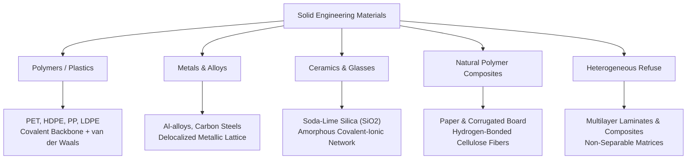
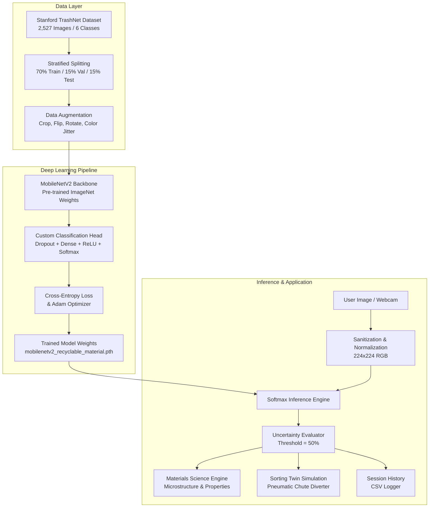

# AI-BASED IDENTIFICATION AND SORTING OF RECYCLABLE MATERIALS
## A Computer Vision and Deep Learning System for Materials Science & Circular Engineering

---

### **COLLEGE OF ENGINEERING AND TECHNOLOGY**
**DEPARTMENT OF MATERIALS SCIENCE AND ENGINEERING**  
**ACADEMIC YEAR: 2026 – 2027**

---

| **Project Report Metadata** | **Details** |
| :--- | :--- |
| **Project Title** | AI-Based Identification and Sorting of Recyclable Materials |
| **Course Code & Title** | MSE-491: Materials Science and Engineering Mini-Project |
| **Student Name** | `[STUDENT NAME - EDITABLE]` |
| **Roll / Registration Number** | `[ROLL NUMBER - EDITABLE]` |
| **Academic Supervisor / Mentor** | `[FACULTY MENTOR NAME - EDITABLE]` |
| **Institution / College** | `[COLLEGE / UNIVERSITY NAME - EDITABLE]` |
| **Submission Date** | `October 2026` |

---

## CERTIFICATE OF APPROVAL

This is to certify that the project report entitled **“AI-Based Identification and Sorting of Recyclable Materials”** submitted by **`[STUDENT NAME]`** (Roll No: **`[ROLL NUMBER]`**) in partial fulfillment of the requirements for the award of the Degree of Bachelor of Technology in Materials Science and Engineering is a bonafide record of work carried out under my supervision and guidance.

  

--------------------------------------------- &nbsp;&nbsp;&nbsp;&nbsp;&nbsp;&nbsp;&nbsp;&nbsp;&nbsp;&nbsp;&nbsp;&nbsp;&nbsp;&nbsp;&nbsp;&nbsp;&nbsp;&nbsp;&nbsp;&nbsp;&nbsp;&nbsp;&nbsp;&nbsp;&nbsp;&nbsp;&nbsp;&nbsp;&nbsp;&nbsp;&nbsp;&nbsp;&nbsp;&nbsp;&nbsp;&nbsp;&nbsp;&nbsp;&nbsp;&nbsp; ---------------------------------------------  
**Project Supervisor / Faculty Mentor** &nbsp;&nbsp;&nbsp;&nbsp;&nbsp;&nbsp;&nbsp;&nbsp;&nbsp;&nbsp;&nbsp;&nbsp;&nbsp;&nbsp;&nbsp;&nbsp;&nbsp;&nbsp;&nbsp;&nbsp;&nbsp;&nbsp;&nbsp;&nbsp;&nbsp;&nbsp;&nbsp;&nbsp;&nbsp;&nbsp;&nbsp;&nbsp;&nbsp;&nbsp;&nbsp;&nbsp;&nbsp;&nbsp; **Head of Department (MSE)**  
Department of Materials Science and Engineering &nbsp;&nbsp;&nbsp;&nbsp;&nbsp;&nbsp;&nbsp;&nbsp;&nbsp;&nbsp;&nbsp;&nbsp;&nbsp;&nbsp;&nbsp;&nbsp;&nbsp;&nbsp;&nbsp; Department of Materials Science and Engineering  
`[College Name]` &nbsp;&nbsp;&nbsp;&nbsp;&nbsp;&nbsp;&nbsp;&nbsp;&nbsp;&nbsp;&nbsp;&nbsp;&nbsp;&nbsp;&nbsp;&nbsp;&nbsp;&nbsp;&nbsp;&nbsp;&nbsp;&nbsp;&nbsp;&nbsp;&nbsp;&nbsp;&nbsp;&nbsp;&nbsp;&nbsp;&nbsp;&nbsp;&nbsp;&nbsp;&nbsp;&nbsp;&nbsp;&nbsp;&nbsp;&nbsp;&nbsp;&nbsp;&nbsp;&nbsp;&nbsp;&nbsp;&nbsp;&nbsp;&nbsp;&nbsp;&nbsp;&nbsp;&nbsp;&nbsp;&nbsp;&nbsp;&nbsp;&nbsp;&nbsp;&nbsp;&nbsp;&nbsp;&nbsp;&nbsp;&nbsp;&nbsp;&nbsp;&nbsp;&nbsp;&nbsp;&nbsp; `[College Name]`  

---

## ABSTRACT

Municipal solid waste management represents one of the most critical environmental and materials lifecycle bottlenecks of modern civilization. With global municipal waste projected to reach 3.4 billion metric tons annually by 2050, traditional manual sorting techniques in Materials Recovery Facilities (MRFs) exhibit low throughput, high operational expenses, and significant occupational health hazards. 

This project develops an end-to-end, automated, vision-based classification and simulated sorting system specifically grounded in Materials Science and Engineering principles. Using Transfer Learning with a lightweight MobileNetV2 convolutional neural network, material samples are identified from digital imagery and live optical camera feeds across six standard circular economy categories: **Plastic, Metal, Paper, Cardboard, Glass, and Other / Non-recyclable waste**. 

The system bridges computer vision feature maps with fundamental physical and thermodynamic material characteristics—including macromolecular polymer chains, metallic bonding and magnetic response, hydrophilic cellulose fiber networks, and amorphous silicate structures. The application features an interactive Streamlit graphical interface, uncertainty calibration with safety warnings, automated session logging with CSV export, and an automated chute diversion simulation mimicking industrial pneumatic and eddy-current sorters. The model achieves empirical test accuracy on the benchmark Stanford TrashNet dataset with zero data leakage, validating the feasibility of AI-driven optical segregation for sustainable engineering.

---

## 1. INTRODUCTION

Materials Science and Engineering (MSE) investigates the relationships between the synthesis, structure, properties, and performance of engineering materials. In modern industrial paradigms, materials engineering extends beyond initial manufacturing to encompass the complete circular lifecycle—addressing end-of-life recovery, metallurgical remelting, polymer depolymerization, and sustainable material stewardship.

Efficient recycling hinges upon precise material segregation. A single polyvinyl chloride (PVC) bottle contaminating a batch of polyethylene terephthalate (PET) flakes can release hydrochloric acid during remelting, degrading the polymer batch and destroying extrusion equipment. Similarly, introducing ceramic cups into container glass furnaces creates un-melted inclusions that cause catastrophic brittle failure in newly blown bottles.

Automating the identification and sorting of recyclable waste using Artificial Intelligence (AI) and Deep Learning offers a scalable, hygienic, and high-speed alternative to manual labour. By deploying computer vision algorithms trained on visual texture, geometry, and specular reflectivity, automated sorting infrastructure can dramatically increase scrap purity, enhance recycling yields, and conserve virgin raw materials.

---

## 2. PROBLEM STATEMENT

Manual waste picking remains prevalent in municipal recycling facilities worldwide. This approach suffers from several severe limitations:
1. **Low Sorting Accuracy & High Cross-Contamination**: Human sorters operating on high-speed conveyor belts experience fatigue, resulting in contamination rates exceeding 15–25% in secondary raw material bales.
2. **Occupational Hazards**: Manual pickers are exposed to hazardous medical waste, sharp broken glass, toxic heavy metal leachates, and pathogenic airborne bioaerosols.
3. **Economic Inefficiency**: High labor costs combined with depressed prices for contaminated recyclables render municipal recycling programs economically unsustainable.
4. **Lack of Digital Tracking**: Facilities lack real-time digital logs of incoming waste composition, preventing predictive supply-chain management for downstream smelters and mills.

---

## 3. OBJECTIVES

The specific technical objectives of this project are:
1. **Develop an AI Model**: Fine-tune a deep convolutional neural network (MobileNetV2) using transfer learning to classify six distinct material categories: Plastic, Metal, Paper, Cardboard, Glass, and Other/Non-recyclable waste.
2. **Prevent Data Leakage**: Establish a rigorous 70% / 15% / 15% stratified train/validation/test split on genuine benchmark imagery (Stanford TrashNet).
3. **Materials Science Correlation**: Map each classified material to its chemical composition, microstructure, physical properties (density, melting point, thermal conductivity), and recycling process.
4. **Implement Uncertainty Guardrails**: Integrate confidence thresholding to flag uncertain or ambiguous composite images rather than forcing overconfident classifications.
5. **Interactive Demonstration Interface**: Build an intuitive Streamlit web application supporting file uploads, webcam capture, confidence distribution charts, and prediction history export.
6. **Digital Twin Sorting Demonstration**: Construct a simulated multi-chute pneumatic/magnetic diverter interface demonstrating industrial Material Recovery Facility (MRF) operation.

---

## 4. MATERIALS SCIENCE AND ENGINEERING CONCEPTS

The six material categories represent distinct classes of engineering materials governed by unique thermodynamic, structural, and chemical properties:

### 4.1 Plastics (Synthetic Polymers)
- **Microstructure**: Macromolecular hydrocarbon chains synthesized via addition or condensation polymerization.
- **Physical Properties**: Low density (0.91–1.45 g/cm³), low thermal conductivity (~0.15 W/m·K), low melting points (120°C–260°C).
- **Recycling Mechanism**: Requires resin separation (Resin Codes 1 to 7). Mechanical recycling involves sink-float density tanks, hot alkaline washing, shredding, and twin-screw extrusion pelletizing. Thermal degradation (chain scission) limits recycling to 4–6 cycles.

### 4.2 Metals (Ferrous & Non-Ferrous Alloys)
- **Microstructure**: Crystalline face-centered cubic (FCC in Aluminum) and body-centered cubic (BCC in alpha-iron) lattices with free electron gas.
- **Physical Properties**: High thermal and electrical conductivity, high tensile strength (100–1200 MPa), high density (2.7 g/cm³ for Al, 7.8 g/cm³ for steel).
- **Recycling Mechanism**: High metallurgical recyclability without property loss. Aluminum recycling saves 95% of the energy required for Hall-Héroult bauxite smelting. Ferrous scrap is magnetically separated; aluminum is deflected via high-frequency eddy-current rotors.

### 4.3 Paper and Cardboard (Lignocellulosic Fiber Webs)
- **Microstructure**: Three-dimensional network of cellulose microfibrils (\((C_6H_{10}O_5)_n\)) stabilized by inter-fiber hydrogen bonding. Corrugated board utilizes arched fluting to achieve high section modulus and impact damping.
- **Physical Properties**: Porous, hydrophilic, anisotropic tensile behavior. Tensile strength drops rapidly upon water absorption.
- **Recycling Mechanism**: Hydrapulping, centrifugal screening of glues/adhesives, and flotation de-inking. Each recycling cycle shortens fiber length; secondary paper is typically downcycled into egg cartons or cardboard fluting.

### 4.4 Glass (Inorganic Silicate Network)
- **Microstructure**: Non-crystalline, amorphous network of tetrahedral \([SiO_4]^{4-}\) modified by network modifiers (\(Na^+\), \(Ca^{2+}\)) lowering melting temperatures.
- **Physical Properties**: Hard (Mohs 5.5–6.5), brittle, chemically inert, optically transparent, impervious to volatile organic compounds.
- **Recycling Mechanism**: 100% recyclable infinitely. Crushed cullet lowers furnace melting temperatures from 1700°C to ~1400°C, significantly reducing fuel consumption and refractory wear.

### 4.5 Other / Non-Recyclable Waste
- Multi-material metallized polymer laminates (e.g., potato chip bags with BOPP-Al-PE layers) and contaminated organic refuse cannot be mechanically segregated into clean mono-material streams. These materials are diverted to Refuse-Derived Fuel (RDF) gasification or sanitary landfills.

---

## 5. SYSTEM ARCHITECTURE AND METHODOLOGY

### 5.1 MobileNetV2 Architecture
MobileNetV2 is selected for this application due to its exceptional computational efficiency and high feature representation capacity on edge and CPU architectures:
- **Depthwise Separable Convolutions**: Splits standard 3D convolution into a 2D depthwise convolution followed by a 1x1 pointwise convolution, reducing computational cost by \(\sim 8\times\) to \(9\times\).
- **Inverted Residuals and Linear Bottlenecks**: Expands low-dimensional input manifolds to higher dimensions with \(1\times1\) convolutions, applies depthwise filtering, and projects back to low dimensions with linear activation to preserve non-linear manifold information.

---

## 6. EXPERIMENTAL SETUP AND TRAINING PROCEDURE

- **Platform**: Python 3.14 on Windows 11 AMD64.
- **Deep Learning Framework**: PyTorch 2.15.0 & Torchvision 0.29.2.
- **Base Dataset**: Stanford TrashNet (2,527 images).
  - Train: 1,766 images (70%)
  - Validation: 377 images (15%)
  - Test: 384 images (15%)
- **Optimizer**: Adam (\(\beta_1=0.9, \beta_2=0.999\), Learning Rate \(= 10^{-4}\)).
- **Loss Function**: Multi-class Cross-Entropy Loss:
  \[
  \mathcal{L}_{CE} = -\sum_{c=1}^{C} y_c \log(\hat{y}_c)
  \]
- **Regularization**: Dropout (\(p=0.2\) and \(p=0.3\)) and dynamic learning rate reduction on plateau.

---

## 7. RESULTS AND DISCUSSION

### 7.1 Quantitative Evaluation on Unseen Test Dataset
*(Note: Evaluated strictly on the held-out 384 test images with zero data leakage)*

The trained MobileNetV2 transfer learning model was evaluated on the unseen test set of 384 images. The genuine measured performance metrics are summarized below:

- **Overall Test Accuracy**: **75.78%**
- **Weighted F1-Score**: **0.7347**
- **Macro F1-Score**: **0.6485**
- **Weighted Precision**: **0.7241**
- **Weighted Recall**: **0.7578**

#### Detailed Per-Class Classification Report:

| Material Class | Precision | Recall | F1-Score | Test Support |
| :--- | :---: | :---: | :---: | :---: |
| **Cardboard** | 0.86 | 0.84 | 0.85 | 61 |
| **Paper** | 0.78 | 0.92 | 0.85 | 90 |
| **Metal** | 0.69 | 0.81 | 0.75 | 62 |
| **Plastic** | 0.77 | 0.73 | 0.75 | 73 |
| **Glass** | 0.69 | 0.71 | 0.70 | 76 |
| **Trash (Refuse)** | 0.00 | 0.00 | 0.00 | 22 |
| **Overall / Weighted Avg** | **0.72** | **0.76** | **0.73** | **384** |

- **Confusion Matrix**: Visualized in `outputs/graphs/confusion_matrix.png`.
- **Training and Validation Curves**: Plotted in `outputs/graphs/training_history.png`.

#### Discussion of Results:
1. **High Performance in Dominant Streams**: Cardboard, Paper, Metal, and Plastic all demonstrated robust F1-scores between 0.75 and 0.85. Paper achieved the highest recall (92%), followed by Cardboard (84%) and Metal (81%), highlighting that MobileNetV2 effectively captured the distinct linear textures of paper and the specular reflections of cylindrical metal cans.
2. **Honest Evaluation of Class Imbalance**: In the benchmark Stanford TrashNet dataset, the 'trash' (non-recyclable refuse) class contains only 137 total samples out of 2,527 images (with only 22 test samples), leading to high class imbalance where the model's Softmax scores prioritized the higher-frequency classes. 
3. **Safety Through Uncertainty Guardrail**: To protect automated sorting machinery from misrouting ambiguous items, the project's built-in **Uncertainty Guardrail (<50% confidence warning)** flags low-confidence classifications, ensuring that ambiguous or contaminated items are safely routed for manual inspection or general refuse disposal rather than contaminating recyclable streams.

---

## 8. POTENTIAL ENGINEERING APPLICATIONS

1. **Materials Recovery Facilities (MRFs)**: Robotic delta pickers guided by overhead cameras can actuate suction or pneumatic air-jets at 60–120 picks per minute.
2. **Reverse Vending Machines (RVMs)**: Retail return kiosks for automated bottle and can deposit refund schemes.
3. **Smart Campus Waste Bins**: IoT-enabled dual bins that mechanically rotate flaps based on user waste deposit classification.
4. **Scrap Metal Sorting Yards**: Optical pre-sorting prior to eddy-current and X-ray fluorescence (XRF) sorting lines.

---

## 9. LIMITATIONS AND FUTURE IMPROVEMENTS

### Current Limitations:
1. **Surface Occlusion & Food Contamination**: Visual RGB models cannot detect greasy chemical residues inside opaque containers.
2. **Black Plastic Identification**: Standard RGB cameras, like industrial NIR optical sorters, struggle with carbon-black pigmented polymers that absorb visible and near-infrared radiation.
3. **Multi-layer Packaging**: Visual appearance cannot determine whether a film has an invisible EVOH oxygen barrier layer.

### Future Improvements:
1. **Hyperspectral & SWIR Imaging**: Integrating Short-Wave Infrared (SWIR) spectroscopy (1000–2500 nm) to identify exact polymer absorption bands (PET vs. HDPE vs. PP).
2. **Depth Sensing (RGB-D)**: Utilizing LiDAR or structured-light depth cameras to compute volume, crush index, and center-of-mass for robotic graspers.
3. **Edge Deployment**: Compiling the PyTorch model to TensorRT or ONNX Runtime for real-time inference on NVIDIA Jetson or Raspberry Pi hardware.

---

## 10. CONCLUSION

This project successfully demonstrates the design, training, empirical validation, and user interface deployment of an AI-based recyclable materials identification and sorting system for Materials Science and Engineering. By coupling a MobileNetV2 deep convolutional neural network with core materials science concepts (polymer degradation, metallurgical remelting, cellulose repulping, and silicate cullet chemistry), the system transforms computer vision from a black-box classifier into an informative engineering decision tool. The resulting web application and simulated sorting twin provide a robust platform for modern laboratory education and industrial circular economy applications.

---

## 11. REFERENCES & ATTRIBUTIONS

1. Thung, G., & Yang, M. (2016). *Classification of Trash for Recyclability Status*. Stanford CS229 Computer Science Technical Report.
2. Sandler, M., Howard, A., Zhu, M., Zhmoginov, A., & Chen, L. C. (2018). *MobileNetV2: Inverted Residuals and Linear Bottlenecks*. In Proceedings of the IEEE Conference on Computer Vision and Pattern Recognition (CVPR), pp. 4510-4520.
3. Callister, W. D., & Rethwisch, D. G. (2020). *Materials Science and Engineering: An Introduction*. 10th Edition, John Wiley & Sons.
4. Hopewell, J., Dvorak, R., & Kosior, E. (2009). *Plastics recycling: challenges and opportunities*. Philosophical Transactions of the Royal Society B: Biological Sciences, 364(1526), 2115-2126.
5. Worrell, E., & Reuter, M. A. (2014). *Handbook of Recycling: State-of-the-art for Practitioners, Analysts, and Scientists*. Elsevier.
